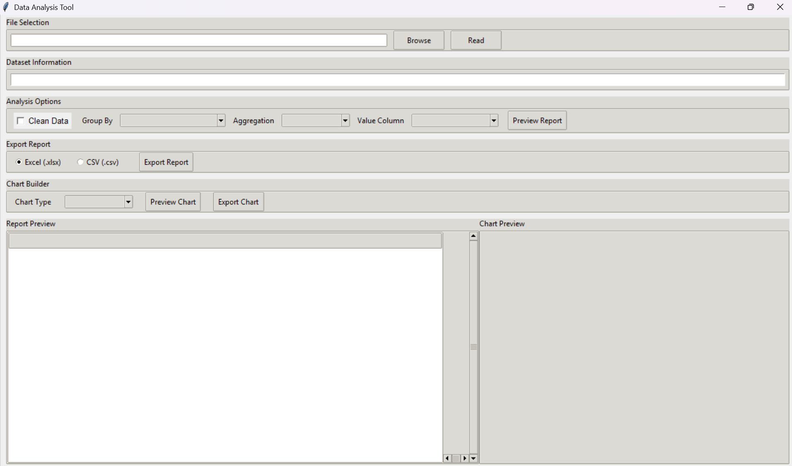

# 📊 Python Project - Data Analysis Tool

A desktop GUI application built with Python and Tkinter that lets you load a dataset, clean it, generate grouped summary reports, and create charts, all without writing any code.



## ✨ Features

- **File Selection**: Browse for and read CSV or Excel files
- **Dataset Information**: View a quick summary of the loaded data (rows, columns, etc.)
- **Data Cleaning**: Optional one-click cleaning (e.g., handling missing values and duplicates)
- **Custom Analysis**: Choose a *Group By* column, an *Aggregation* (sum, mean, count, etc.), and a *Value Column*
- **Report Preview**: See the generated report inside the app before exporting
- **Export Reports**: Save results as Excel (.xlsx) or CSV (.csv)
- **Chart Builder**: Preview charts in-app and export them as image files

## 🛠️ Technologies Used

- Python 3.x
- Tkinter (GUI)
- pandas (data processing)
- matplotlib (charts)
- openpyxl (Excel support)

## 🚀 Installation

1. Clone the repository:
```bash
   git clone https://github.com/sulagna01royofficial/Python-Project-Data-Analysis-Tool.git
   cd Python-Project-Data-Analysis-Tool
```

2. (Optional) Create a virtual environment:
```bash
   python -m venv venv
   venv\Scripts\activate      # Windows
   source venv/bin/activate   # macOS/Linux
```

3. Install dependencies:
```bash
   pip install -r requirements.txt
```

## ▶️ Usage

Run the application:

```bash
python main.py
```

1. Click **Browse** and select a CSV or Excel file, then click **Read**.
2. Review the dataset summary.
3. (Optional) Tick **Clean Data**.
4. Select **Group By**, **Aggregation**, and **Value Column**, then click **Preview Report**.
5. Choose Excel or CSV and click **Export Report** to save it.
6. Pick a **Chart Type**, click **Preview Chart**, then **Export Chart** to save it.

## 📁 Project Structure

```
data-analysis-tool/
├── main.py
├── requirements.txt
├── screenshots/
│   └── app_screenshot.png
├── sample_data/
│   └── sample.csv
└── README.md
```

## 📦 Requirements

```
pandas
matplotlib
openpyxl
```

## 🔮 Future Improvements

- Support for more file formats (JSON, Parquet)
- More chart types and customization
- Filtering and sorting options
- Dark mode

## 🤝 Contributing

Contributions, issues, and feature requests are welcome. Feel free to open an issue or submit a pull request.

## 📄 License

This project is licensed under the MIT License.

## 👤 Author

**Sulagna Roy**
[GitHub](https://github.com/sulagna01royofficial)
